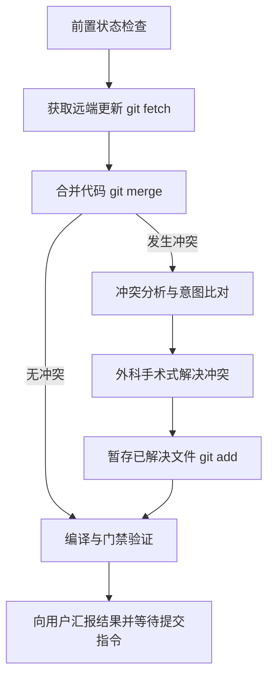

# Sync GitHub Origin

用于安全地从上游仓库 `github-origin` 的 `main` 分支拉取最新代码，合并到当前工作分支，并系统化解决潜在合并冲突的专属技能。

---

## 核心操作流程



---

## 详细步骤指引

### 步骤一：前置检查与环境确认

1. **工作区状态自检**：
   - 执行 `git status` 确认当前工作区是否干净。
   - 若存在尚未提交的本地修改，必须先向用户提示或经确认后保存修改，避免与后续拉取产生混合污染。
2. **确认当前分支**：
   - 确认当前正在工作的分支，**严禁私自切换分支或新建分支**。
3. **检查 Remote 配置**：
   - 确认本地已配置名为 `github-origin` 的远程源：
     ```powershell
     git remote -v
     ```
   - 若不存在 `github-origin`，提示用户确认远程仓库别名（如确认上游地址是否配置正确）。

### 步骤二：拉取上游最新分支

1. **Fetch 上游最新变更**：
   ```powershell
   git fetch github-origin main
   ```
2. **比对变更规模（可选但推荐）**：
   - 查看上游 `main` 有多少新提交待合并：
     ```powershell
     git log HEAD..github-origin/main --oneline -n 10
     ```

### 步骤三：执行合并

1. **执行 Merge 命令**：
   ```powershell
   git merge github-origin/main
   ```
2. **判断结果**：
   - **Case A（自动合并成功）**：未产生冲突，直接跳至**步骤六：编译与门禁验证**。
   - **Case B（合并产生冲突）**：提示 `CONFLICT (content): Merge conflict in ...`，进入**步骤四：冲突排查与深入分析**。

### 步骤四：冲突排查与意图分析

1. **列出所有冲突文件**：
   ```powershell
   git status --short
   ```
   筛选出带有 `UU`（Both Modified）、`UD`/`DU` 等冲突状态的文件。

2. **追溯双方变更意图**（不要盲目覆盖）：
   - 理解本地改动意图（`HEAD` / Ours）：查看本地针对该文件的近期提交记录。
   - 理解上游改动意图（`github-origin/main` / Theirs）：查看上游针对该文件的提交信息与 diff：
     ```powershell
     git log -p -n 3 github-origin/main -- <conflict_file_path>
     ```
   - **权衡原则**：
     - 若两处改动互不排斥（如各自新增了独立的导入、状态、函数或配置），兼顾并保留双方特性。
     - 若两处改动有直接逻辑互斥或属于重大架构重构，禁止凭空猜测，需向用户清晰列出利弊与方案，等待用户裁决。

### 步骤五：外科手术式解决冲突

1. **定位并消除冲突标记**：
   - 查找文件中的 `<<<<<<< HEAD`、`=======`、`>>>>>>> github-origin/main`。
   - 针对每一处冲突，按分析结论进行精准修改，消除标记。
2. **规范要求**：
   - 不借机格式化无关代码。
   - 保持原有缩进风格、引号与命名规范一致。
   - 遵循全局准则：禁止空值合并 `??`（用 `||` 代替）、禁止可选链 `?.`、禁止 `var`。
3. **暂存解决后的文件**：
   ```powershell
   git add <conflict_file_path>
   ```

### 步骤六：编译与门禁验证

在所有冲突解决后，必须执行本项目的自动化编译与类型检查，确保合并后无语法报错或逻辑破损。

1. **Rust 后端校验**（⚠️ **必须在 `src-tauri` 目录执行**）：
   ```powershell
   # 必须在 src-tauri 工作目录下执行 Cargo 命令
   cargo check
   ```
   *注意：使用 run_command 工具时，将 Cwd 参数指定为 `f:\rust_projects\cc-switch\src-tauri`。*

2. **前端类型校验**：
   ```powershell
   # 在仓库根目录下执行
   pnpm run typecheck
   ```

3. **前端单元测试（如有涉及前端逻辑改动）**：
   ```powershell
   pnpm run test:unit
   ```

若验证发现编译报错或类型错误，追查是否为上游接口变更、导入路径变动或类型定义更新导致，针对性修正后再次验证。

### 步骤七：收尾汇报与交付

1. **确认冲突已全部标记解决**：
   - 运行 `git status` 确认没有未解决的冲突标记。
2. **严格遵守交付红线**：
   - ❌ **严禁自行执行 `git commit` 或 `git push`**。
   - 所有文件已通过 `git add` 暂存且验证无误后，向用户输出完整的解决报告：
     - 包含本次合并拉取的提交概况；
     - 发生冲突的文件列表以及冲突解决的逻辑方案；
     - 前后端验证结果（`cargo check`、`pnpm run typecheck` 等通过情况）；
     - 提示用户由用户自主提交或在需要时发出明确指令。
